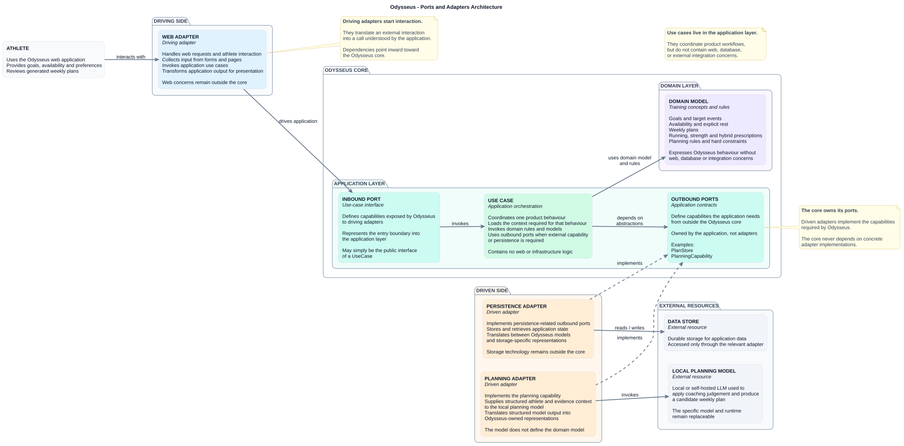

# Odysseus — Architecture Overview

## Purpose

This document describes the current high-level architecture of Odysseus.

Odysseus uses a pragmatic ports-and-adapters architecture so that product and
training behaviour remain independent of web frameworks, persistence technology,
external integrations, and planning runtimes.

The architecture should evolve as real product capabilities require it.

It should not be used as a reason to introduce abstractions, packages, adapters,
or infrastructure before they have a concrete purpose.

---

## Architecture

Odysseus is divided into three broad areas:

- the **driving side**, where interactions with the application begin;
- the **Odysseus core**, containing application and domain behaviour;
- the **driven side**, where the core reaches external capabilities through
  adapters.

External resources remain outside the Odysseus core.

---

## Driving side

Driving adapters translate external interactions into application behaviour.

For the current product, the primary driving adapter is the web application.

The web adapter is responsible for concerns such as:

- receiving athlete input;
- handling web requests;
- presenting application output;
- translating forms and web interactions into application calls.

Web-specific behaviour should not leak into the application or domain layers.

FastAPI and other web technologies therefore belong on this side of the
architecture.

---

## Application layer

The application layer coordinates Odysseus product behaviour.

A **use case** represents a meaningful application operation, such as generating
a weekly plan or updating athlete availability.

Use cases may:

- gather the context required for an operation;
- invoke domain behaviour;
- coordinate multiple domain concepts;
- use outbound ports where persistence or another external capability is
  required.

Use cases should not contain:

- HTTP or template concerns;
- database-specific behaviour;
- external integration logic;
- planning-runtime-specific behaviour.

The public interface of a use case may itself act as the inbound port. A
separate interface abstraction should only be introduced where it provides a
real benefit.

For weekly planning, the application layer also coordinates the planning cycle.

Odysseus prepares the authoritative athlete and evidence context before invoking
the planning capability.

The resulting candidate plan is then validated by Odysseus before it may become
active.

If validation fails, the application may request a corrected plan using the
validation failures as feedback. Planning is retried up to the product-defined
limit before failing visibly.

---

## Domain layer

The domain layer represents the training concepts and rules that make Odysseus
what it is.

Examples include:

- goals and target events;
- availability and explicit rest;
- weekly plans;
- running prescriptions;
- strength prescriptions;
- hybrid / HYROX prescriptions;
- planning rules and constraints.

The domain should express these concepts without knowledge of:

- FastAPI;
- databases;
- Garmin;
- Hevy;
- Hyresult;
- planning models or runtimes;
- deployment technology.

The domain describes Odysseus behaviour rather than the technologies used to
deliver it.

---

## Outbound ports

Outbound ports define capabilities the application requires from outside the
core.

For example, the application may need:

- somewhere to persist and retrieve plans;
- a capability capable of producing planning output.

The application owns these contracts.

Concrete technologies do not define what the core needs.

This dependency direction is fundamental:

`Application -> Port <- Adapter`

rather than:

`Application -> Concrete technology`

---

## Driven adapters

Driven adapters implement outbound ports using concrete technology.

Examples expected within the current scope include:

- a persistence adapter;
- a planning adapter.

The persistence adapter translates between Odysseus application concepts and
the chosen storage technology.

The planning adapter translates between Odysseus planning context and the local
or self-hosted LLM used for planning.

It is responsible for presenting structured context and planning instructions in
the form required by the selected model/runtime and translating structured model
output back across the application boundary.

The planning adapter does not decide athlete facts, hard constraints, plan
validity, or the meaning of Odysseus domain objects.

The LLM provides coaching judgement within this boundary.

Odysseus remains responsible for the authoritative athlete context, evidence
context, structured representations, hard constraints, and validation of the
candidate plan.

---

## External resources

For `v0.1`, the planning resource is a local or self-hosted LLM.

The exact model and serving/runtime technology are not fixed by this
architecture. They remain replaceable behind the planning adapter and
`PlanningCapability` port.

Future systems such as Garmin, Hevy, and Hyresult will also sit outside the
Odysseus core and should be introduced through adapters when those capabilities
enter active product scope.

They are intentionally absent from the current architecture diagram.

---

## Dependency rule

Dependencies should point toward Odysseus-owned behaviour and contracts.

In particular:

- driving adapters depend on application behaviour;
- use cases depend on domain behaviour and outbound-port abstractions;
- driven adapters depend on Odysseus-owned ports;
- the domain depends on no web, persistence, or integration technology.

This keeps external technology replaceable without forcing changes into the
core product model.

---

## Current architectural boundaries

The architecture establishes direction without prematurely deciding every
implementation detail.

The current architecture does **not** yet require decisions about:

- the final persistence technology;
- the specific local LLM model;
- the model-serving/runtime technology;
- whether lightweight current-research retrieval is added beyond the curated
  evidence context;
- Garmin adapter structure;
- Hevy adapter structure;
- Hyresult adapter structure;
- authentication architecture;
- background-job infrastructure;
- deployment topology.

Those decisions should be made when the corresponding product capability
requires them.

---

## Evolution rule

Architecture documentation describes the system that exists or is actively
being designed.

When new product capabilities introduce new adapters, ports, infrastructure, or
important architectural relationships, this document and its diagrams should be
updated.

The architecture should grow from product needs rather than from a desire to
pre-design the finished system.