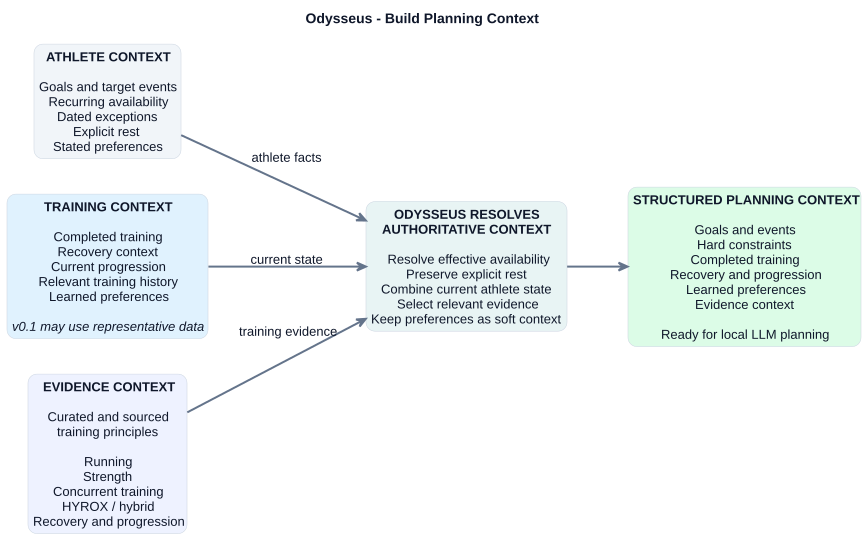
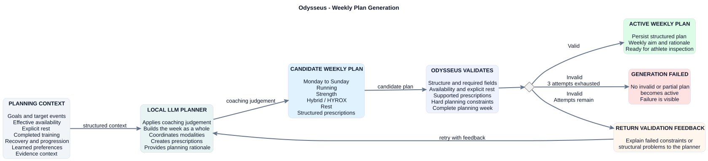
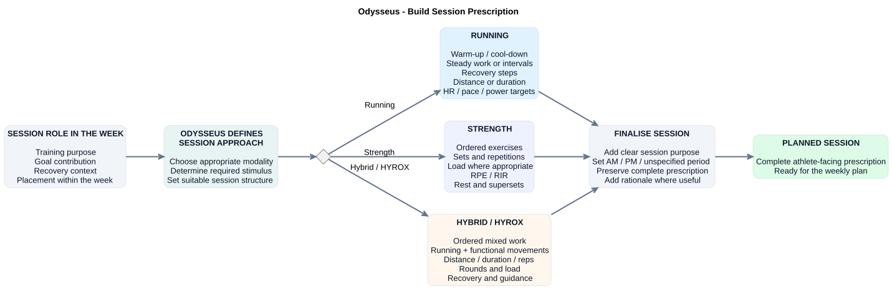
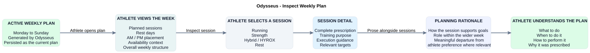

# Odysseus — Product Workflows

## Purpose

This document describes the key end-to-end product workflows currently supported
by Odysseus.

The workflows are intentionally described from a product perspective. They show
what the athlete and Odysseus do, not how the behaviour is implemented.

`requirements.md` remains authoritative for product behaviour, while `scope.md`
defines which capabilities are currently in scope.

This is a living document and should evolve as new product capabilities are
introduced.

---

## Cancel a target event or goal

The athlete explicitly cancels a target event. Odysseus marks the event and all
its ACTIVE linked goals as CANCELLED together, retaining the links and all other
goal details. COMPLETED, INACTIVE, and already CANCELLED linked goals, goals for
other events, and standalone goals remain unchanged.

This relationship is one-way: cancelling an individual goal does not cancel its
event or any other goal linked to that event.

Reactivating an event leaves its cancelled goals cancelled. Individual goals
can be updated explicitly afterwards. An attempt to create or update an ACTIVE
goal linked to a still-CANCELLED event is rejected without saving changes.

Completing or deactivating an event does not trigger goal cancellation, and
passing dates do not trigger status changes. Deleting an event is distinct from
cancelling it: deletion removes the event and unlinks its goals while preserving
their statuses.

---

## Select future preparation targets

For a supplied reference date, Odysseus selects ACTIVE goals with no target date
or a target date on or after that date, and ACTIVE events dated on or after it.
Linked goals also require their referenced event to exist and qualify. Targets
dated exactly on the reference date are included.

The selection retains stored order and leaves all records and statuses intact.
All excluded records remain accessible through ordinary list and retrieve
operations. Past and completed records can inform historical context without
being treated as upcoming preparation targets. This query does not calculate
recovery windows or generate a training plan.

---

## Build planning context

Before generating a training week, Odysseus builds a structured planning context
from authoritative athlete information, current training state, explicit
preferences, any available inferred preferences, and evidence-informed training
knowledge.

Odysseus resolves the information before it reaches the planner.

Important product rules:

- recurring availability and dated exceptions are resolved into effective
  availability;
- explicit rest remains a hard constraint;
- athlete preferences are planning context, not mandatory rules;
- inferred preferences may influence planning without becoming hard constraints;
- completed-training and recovery context describe the athlete's current state;
- relevant evidence-informed training principles are supplied explicitly to the
  planner;
- the planner receives Odysseus-owned context rather than Garmin, Hevy,
  Hyresult, web, or persistence representations.

In `v0.1`, recent training context may initially be supplied manually or through
representative application data.

---

## Generate the weekly plan

Odysseus uses the structured planning context to generate a coherent
Monday-to-Sunday training week.

A local or self-hosted LLM provides the coaching judgement required to create
the candidate week.

The LLM may decide:

- weekly training structure;
- session selection and placement;
- volume and intensity;
- progression;
- recovery balance;
- exercise selection;
- interaction between running, strength, and hybrid training;
- when prescribed training should differ from athlete preferences.

Meaningful departures from explicit preferences are explained without
overwriting those preferences.

Odysseus retains responsibility for authoritative athlete facts, hard
constraints, structured representations, and validation.

The generated candidate plan must pass both structural and product validation
before becoming active.

If validation fails, Odysseus provides the failures back to the planning
capability and requests a corrected plan.

A maximum of three generation attempts is allowed.

If no valid plan can be produced, generation fails visibly and no invalid or
partial plan becomes active.

There is no athlete approval gate between successful validation and activation.

---

## Build session prescriptions

Once the role of a session within the week is known, Odysseus creates the
appropriate detailed prescription for that session.

Running, strength, and hybrid / HYROX sessions may require different structures,
but each prescription should clearly express:

- what the athlete should do;
- the intended training stimulus;
- relevant execution guidance;
- the purpose of the session within the wider week.

The Odysseus prescription represents the intended workout independently of
future execution-platform limitations such as Garmin workout formats.

---

## Inspect the weekly plan

The active weekly plan is presented through the web application so the athlete
can understand both the week's structure and individual session prescriptions.

The athlete can move from the weekly overview into individual session detail.

Session detail provides the complete prescription and relevant execution
guidance, with planning rationale presented alongside sessions where useful.

The athlete should be able to understand:

- what to do;
- when to do it;
- how to perform it;
- why it was prescribed.

---

## Current workflow boundary

These diagrams describe the workflows currently in scope.

Future workflows such as Garmin workout delivery, completed-training ingestion,
planned-versus-completed matching, adaptive replanning, analytics, and automated
learning should be added only when those capabilities enter active product
scope.

They should not be designed here in advance simply because they are known
future requirements.
